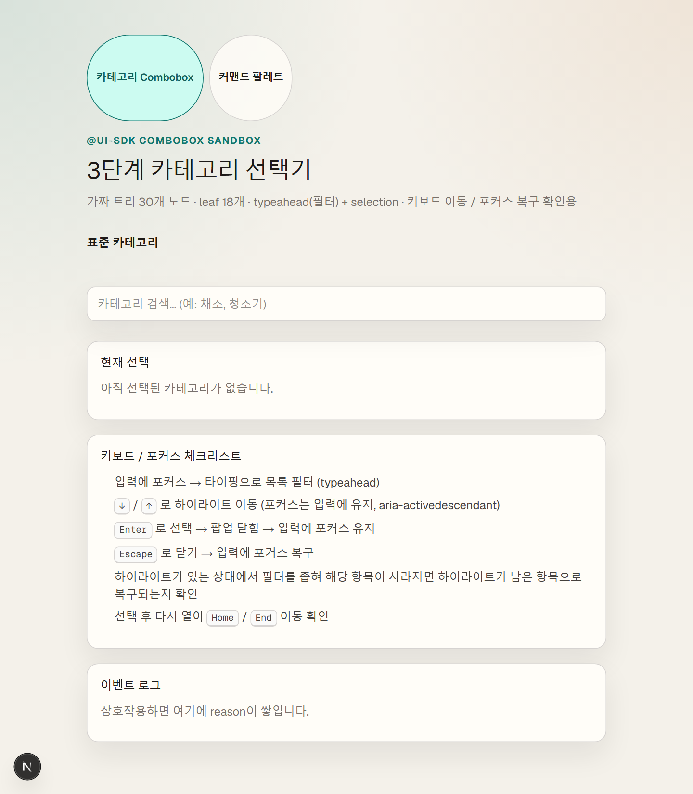
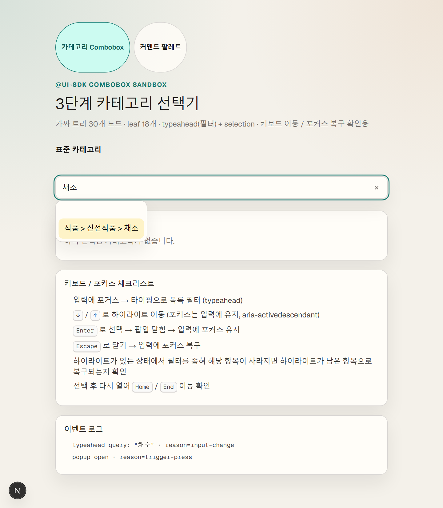
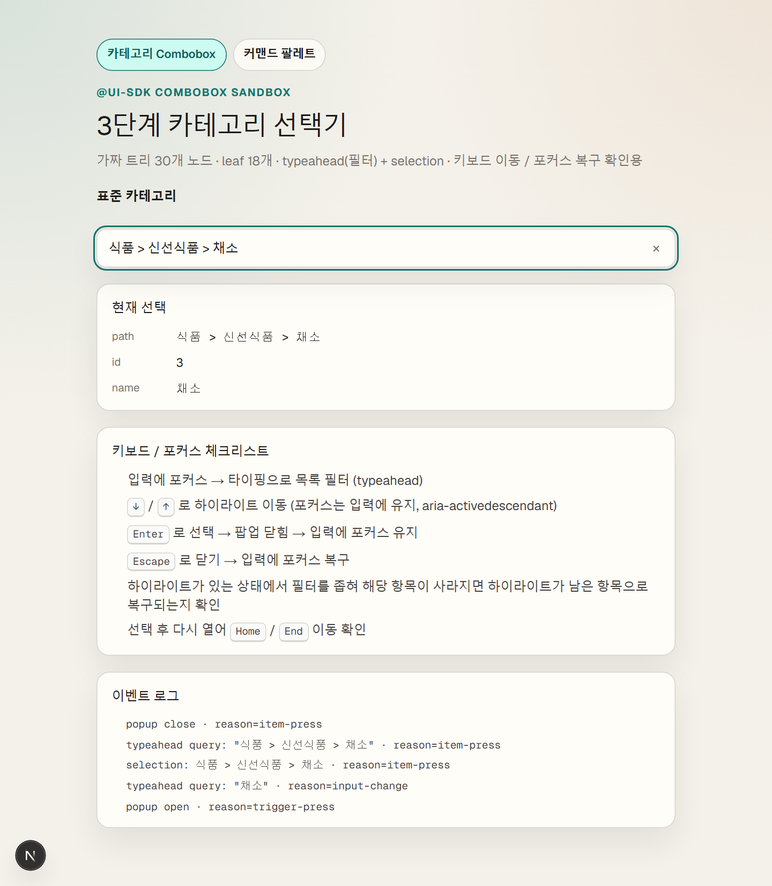
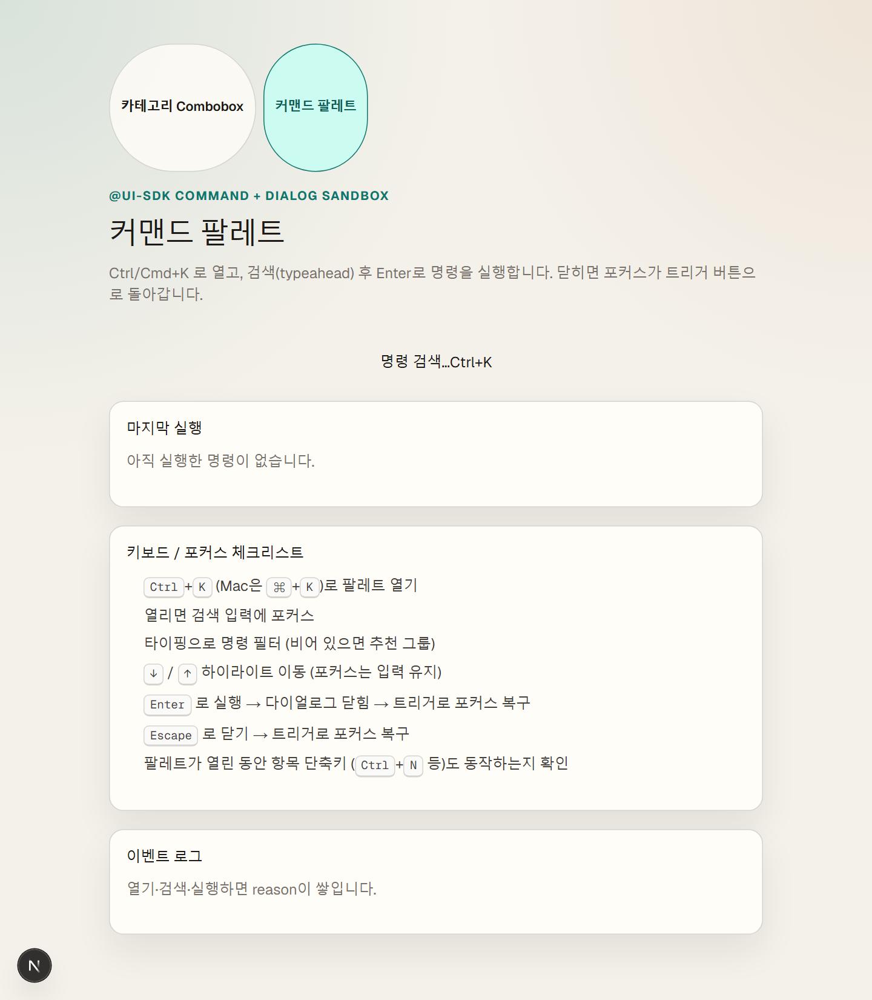
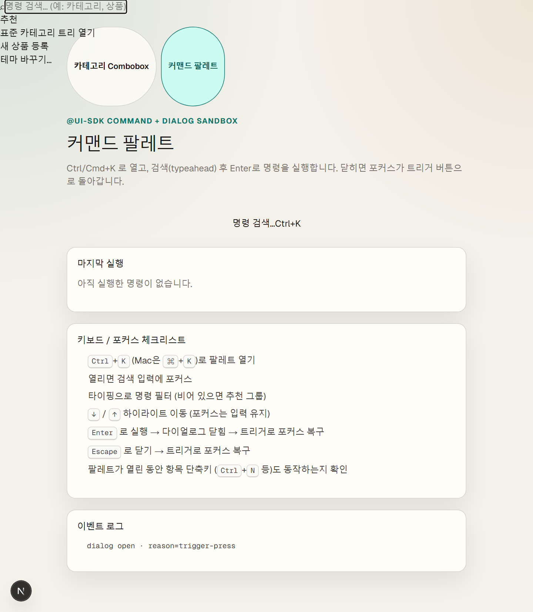
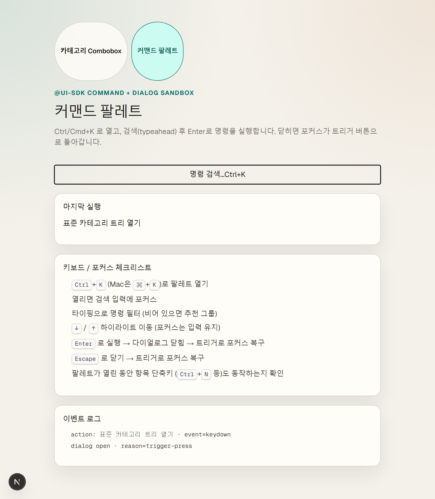

# UI SDK Gives You Behaviors, Not Just Components: Combobox & Command Palette in Next.js

> Hands-on notes with Vercel UI SDK (`@ui-sdk/react` / `@ui-sdk/core`)  
> Demo source: https://github.com/seulgi-i/ui-sdk-demos  
> Run locally: `npm run dev -- --port 3010`

## TL;DR

Most UI libraries ship a finished Select. UI SDK starts from **behaviors**?봩eyboard movement, focus recovery, selection, typeahead?봞nd builds Combobox, Command, and friends on top.  
This post shows the difference with two demos: a **3-level category Combobox** and a **command palette**.

## What is UI SDK? (Select-only explanation)

If you build a Select from scratch, you usually own all of this:

1. Open / close  
2. Filter as you type (typeahead)  
3. Move with `?? / `??  
4. Choose with `Enter`  
5. Dismiss with `Escape`  
6. Put focus back where it belongs  
7. Keep the highlight sane when filtering removes the active item  

UI SDK packages those interactions as reusable **behaviors**.  
In React you can use assembled parts (`@ui-sdk/react/combobox`, `@ui-sdk/react/command`) or compose `@ui-sdk/core` yourself.

> It is **not** an LLM or chat API. It is a **frontend UI library**.  
> The ?쏿gent-friendly??angle is: agents (and humans) reuse the same tested interaction contracts instead of reinventing focus and keyboard every time.

## Demo 1 ??3-level category Combobox

We use a fake category tree with **30 nodes** and **18 leaves**.  
Type to filter, arrow to move, Enter to select.

### Idle



### Filter with `梨꾩냼` (vegetable)



- Query `梨꾩냼` ??one matching leaf  
- DOM focus stays on the **input**  
- Highlight is wired through `aria-activedescendant`  

### After Enter



- Selected path appears in the input and the selection panel  
- Popup closes; focus remains on the input  

### Pitfall we hit

Mapping every `ComboboxItem` by hand inside `ComboboxList` **did not hide non-matches**.  
Passing `items` and letting the list **auto-render** made typeahead filtering work.

```tsx
<Combobox items={items} value={value} onValueChange={setValue}>
  <ComboboxInput placeholder="Search categories?? />
  <ComboboxContent>
    <ComboboxEmpty>No matching categories.</ComboboxEmpty>
    <ComboboxList /> {/* auto-render from items */}
  </ComboboxContent>
</Combobox>
```

## Demo 2 ??Command palette (Dialog + Command)

If Combobox is ?쐏ick one value,??a command palette is ?쐓earch and **run an action**.?? 
Open with `Ctrl/Cmd+K`. After run or Escape, focus returns to the **trigger**.

### Idle



### Open (suggested commands)



- Focus moves to the search input  
- Empty query shows three `emptyItems` suggestions  

### Filter with `移댄뀒怨좊━` (category)


### After Enter



- `Enter` runs the command and closes the dialog  
- Focus restores to `dialog-trigger`  
- `Escape` does the same (`reason=escape-key`)  

```tsx
<Dialog open={open} onOpenChange={setOpen}>
  <DialogTrigger shortcut="mod+k">Search commands??/DialogTrigger>
  <DialogContent>
    <Command
      items={COMMANDS}
      emptyItems={SUGGESTED}
      onAction={(value) => {
        run(value);
        setOpen(false); // Dialog restores focus to the trigger
      }}
    >
      <CommandInput aria-label="Search commands" />
      <CommandEmpty>No matching commands.</CommandEmpty>
      <CommandList />
    </Command>
  </DialogContent>
</Dialog>
```

## Run it locally

```bash
git clone https://github.com/seulgi-i/ui-sdk-demos.git
cd ui-sdk-demos
npm install
npm run dev -- --port 3010
```

- Combobox: http://localhost:3010/  
- Command: http://localhost:3010/command  

## What this experiment gives you

1. **Concept**: UI SDK = tested **interaction parts**, not only styled widgets  
2. **Practical judgment**: enough evidence to decide if it fits a BO category picker or global shortcut UI  
3. **A recorded pitfall**: manual item maps vs `items` auto-render  

## Links

- UI SDK: https://ui-sdk.dev  
- Upstream: https://github.com/vercel-labs/ui  
- This demo: https://github.com/seulgi-i/ui-sdk-demos  
