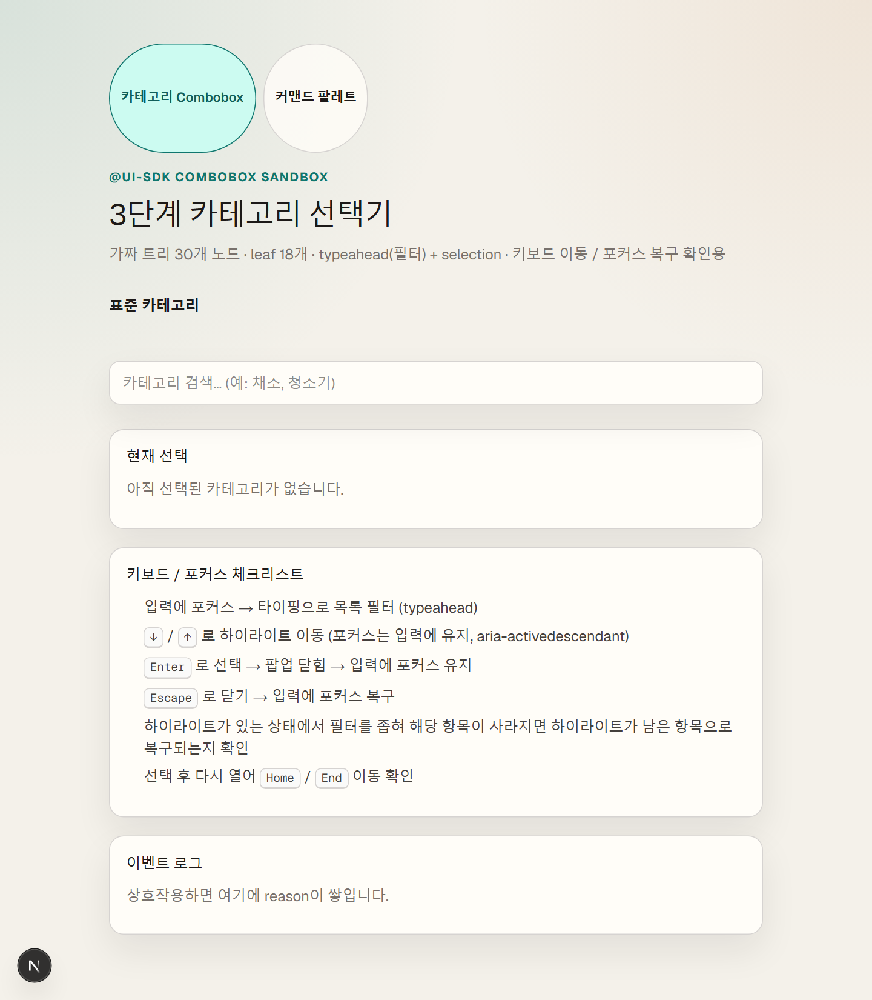
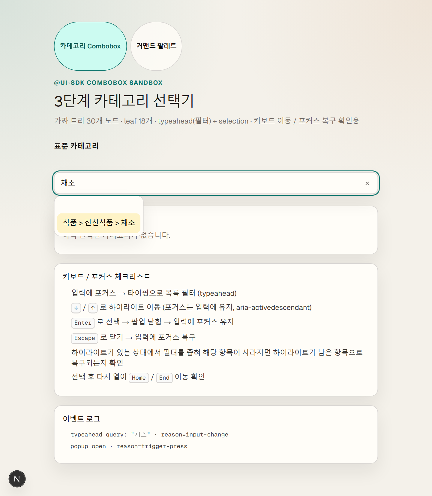
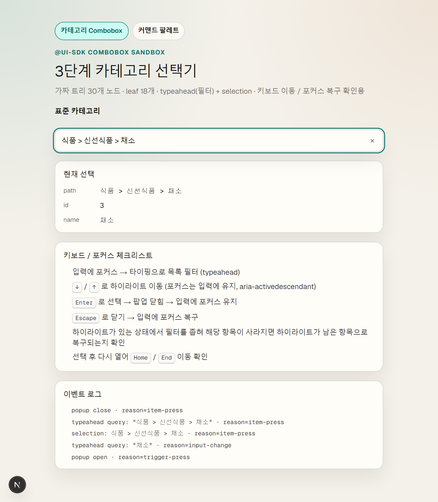
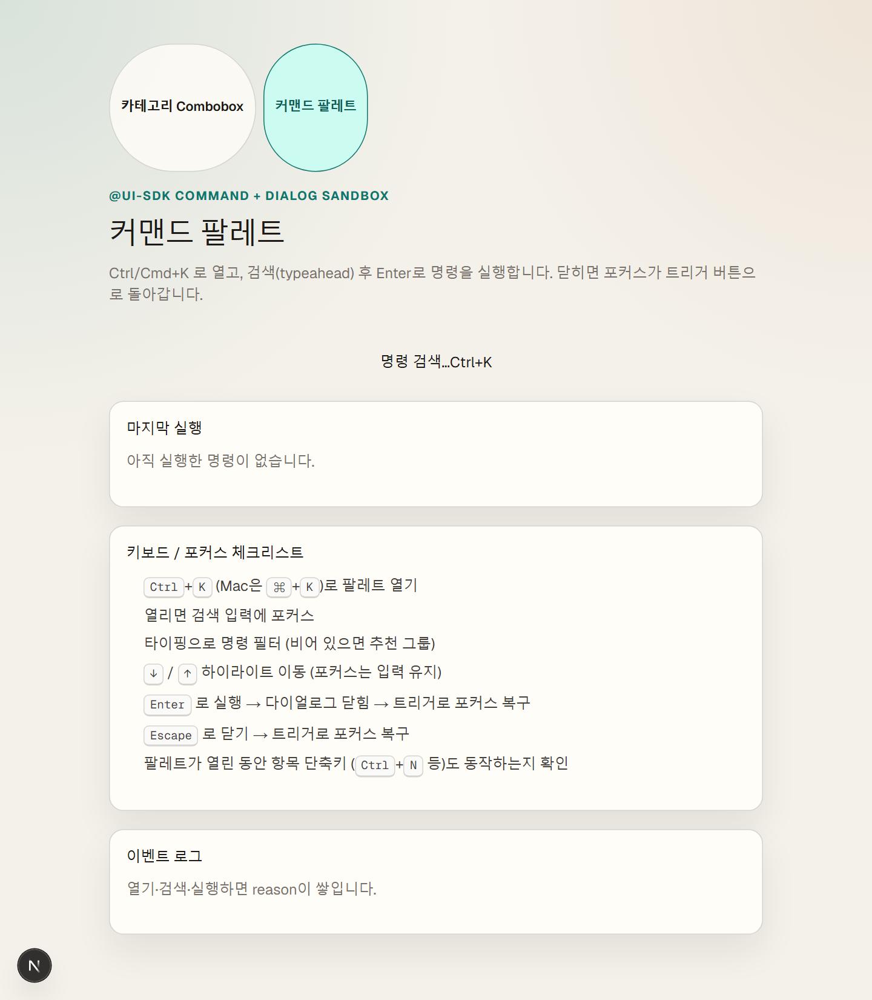
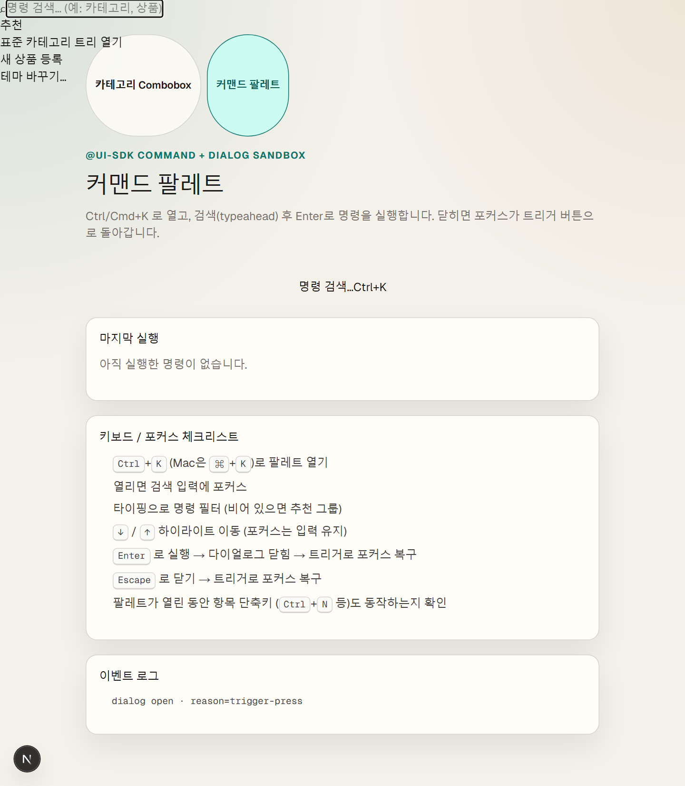
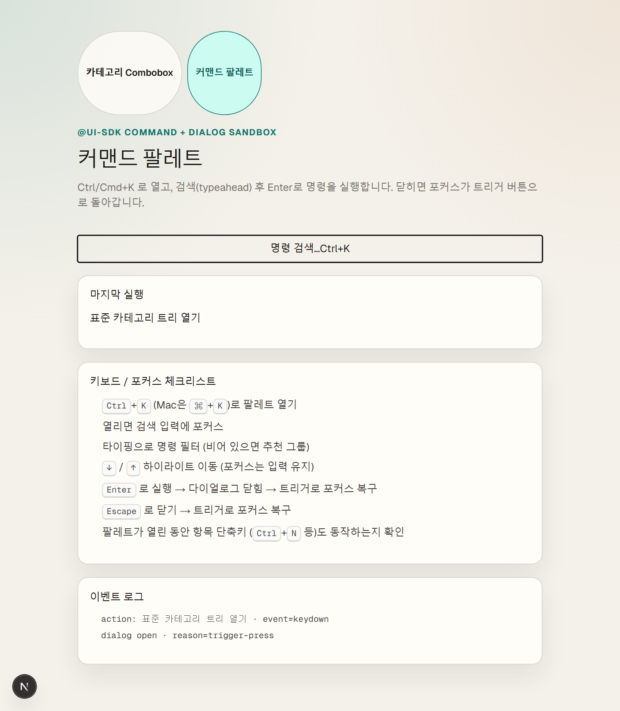

# 而댄룷?뚰듃 ?€???섎룞?묅€숈쓣 二쇰뒗 UI SDK, Next.js濡?Combobox쨌而ㅻ㎤???붾젅??留뚮뱾??蹂닿린

> Vercel UI SDK (`@ui-sdk/react` / `@ui-sdk/core`) ?뚮뱶諛뺤뒪 ?ㅽ뿕 湲곕줉  
> ?곕え ?뚯뒪: https://github.com/seulgi-i/ui-sdk-demos  
> 濡쒖뺄 ?ㅽ뻾: `npm run dev -- --port 3010`

## ??以??붿빟

?쇰컲 UI ?쇱씠釉뚮윭由ш? **?꾩꽦??Select 而댄룷?뚰듃**瑜?以€?ㅻ㈃, UI SDK??**?ㅻ낫?쑣룻룷而ㅼ뒪쨌?좏깮쨌寃€??媛숈? ?숈옉(behavior)** ??癒쇱? 二쇨퀬, 洹??꾩뿉 Combobox쨌Command 媛숈? 遺€?덉쓣 ?щ┰?덈떎.  
??湲€?€ ?쒓렇?섏꽌 萸먭? ?ㅻⅤ???앸? **移댄뀒怨좊━ Combobox**?€ **而ㅻ㎤???붾젅??* ???곕え濡?蹂댁뿬 以띾땲??

## UI SDK媛€ 萸붽??? (?€?됲듃濡쒕쭔 ?ㅻ챸)

Select瑜?吏곸젒 留뚮뱾硫?蹂댄넻 ?대윴 嫄???吏쒖빞 ?⑸땲??

1. ?닿린 / ?リ린  
2. ?€?댄븨?댁꽌 紐⑸줉 以꾩씠湲?(typeahead)  
3. `?? `?? 濡???ぉ ?대룞  
4. `Enter` 濡?怨좊Ⅴ湲? 
5. `Escape` 濡??リ린  
6. ?ロ엺 ???ъ빱?ㅺ? ?대뵒濡??뚯븘媛덉?  
7. ?꾪꽣濡???ぉ???щ씪議뚯쓣 ???섏씠?쇱씠?멸? 源⑥?吏€ ?딄쾶 ?섍린  

UI SDK????以?**2~7踰덉쓣 寃€利앸맂 ?숈옉 ?⑥쐞**濡??쒓났?⑸땲??  
React?먯꽌??`@ui-sdk/react/combobox`, `@ui-sdk/react/command`泥섎읆 **?대? 議곕┰??遺€??*???⑤룄 ?섍퀬, `@ui-sdk/core`??behavior留?怨⑤씪 ?곕━ ?쇳븨紐곗슜 UI瑜?留뚮뱾?대룄 ?⑸땲??

> AI 紐⑤뜽/梨꾪똿 API媛€ ?꾨떃?덈떎. **?꾨줎?몄뿏??UI ?쇱씠釉뚮윭由?*?낅땲??  
> ?쒖뿉?댁쟾?멸? UI瑜??앹꽦?????ъ빱?ㅒ룻궎蹂대뱶瑜?留ㅻ쾲 ?덈줈 吏쒖? ?딄쾶???섎젮???ㅺ퀎媛€ ?ъ씤?몄엯?덈떎.

## ?곕え 1 ??3?④퀎 移댄뀒怨좊━ Combobox

媛€吏?移댄뀒怨좊━ ?몃━ **30?몃뱶** 以?leaf **18媛?*瑜?怨좊쫭?덈떎.  
寃€?됱갹??移섎㈃ 紐⑸줉??以꾧퀬, ?붿궡?쒕줈 ?대룞????Enter濡??좏깮?⑸땲??

### 泥섏쓬 ?붾㈃



### `梨꾩냼`濡??꾪꽣



- 荑쇰━ `梨꾩냼` ??留ㅼ묶 leaf 1媛? 
- DOM ?ъ빱?ㅻ뒗 **?낅젰李쎌뿉 ?좎?**  
- ?섏씠?쇱씠?몃뒗 `aria-activedescendant`濡??곌껐  

### Enter濡??좏깮 ??


- ?좏깮 path媛€ ?낅젰쨌?좏깮 ?⑤꼸??諛섏쁺  
- ?앹뾽???ロ????ъ빱?ㅻ뒗 ?낅젰???⑥쓬  

### 援ы쁽?먯꽌 嫄몃┛ ?⑥젙

`ComboboxList` ?덉뿉 `ComboboxItem`???꾨? ?섎룞?쇰줈 `map`?섎㈃ **?꾪꽣媛€ ??ぉ???④린吏€ ?딆븯?듬땲??**  
`items`留??섍린怨?List瑜?**?먮룞 ?뚮뜑**?댁빞 typeahead ?꾪꽣媛€ ?숈옉?덉뒿?덈떎.

```tsx
<Combobox items={items} value={value} onValueChange={setValue}>
  <ComboboxInput placeholder="移댄뀒怨좊━ 寃€?됤€? />
  <ComboboxContent>
    <ComboboxEmpty>?쇱튂?섎뒗 移댄뀒怨좊━媛€ ?놁뒿?덈떎.</ComboboxEmpty>
    <ComboboxList /> {/* ?먯떇 ?놁씠 ?먮룞 ?뚮뜑 */}
  </ComboboxContent>
</Combobox>
```

## ?곕え 2 ??而ㅻ㎤???붾젅??(Dialog + Command)

?€?됲듃媛€ ?쒕ぉ濡앹뿉??**?섎굹 怨좊Ⅴ湲?*?앸씪硫? 而ㅻ㎤???붾젅?몃뒗 ?쒓??됲빐??**紐낅졊 ?ㅽ뻾?섍린**?앹엯?덈떎.  
`Ctrl/Cmd+K`濡??닿퀬, ?ㅽ뻾 ??**?몃━嫄?踰꾪듉?쇰줈 ?ъ빱?ㅺ? ?뚯븘?듬땲??**

### 泥섏쓬 ?붾㈃



### ?대졇????(異붿쿇 紐낅졊)



- ?대━硫?寃€???낅젰???ъ빱?? 
- 鍮?寃€?됱씠硫?`emptyItems` 異붿쿇 3媛? 

### `移댄뀒怨좊━`濡??꾪꽣


### Enter濡??ㅽ뻾 ??


- `Enter` ??紐낅졊 ?ㅽ뻾 + ?ㅼ씠?쇰줈洹??ロ옒  
- ?ъ빱????`dialog-trigger` 濡?蹂듦뎄  
- `Escape`???숈씪?섍쾶 ?몃━嫄곕줈 蹂듦뎄 (`reason=escape-key`)  

```tsx
<Dialog open={open} onOpenChange={setOpen}>
  <DialogTrigger shortcut="mod+k">紐낅졊 寃€?됤€?/DialogTrigger>
  <DialogContent>
    <Command
      items={COMMANDS}
      emptyItems={SUGGESTED}
      onAction={(value) => {
        run(value);
        setOpen(false); // Dialog媛€ ?몃━嫄곕줈 ?ъ빱??蹂듦뎄
      }}
    >
      <CommandInput aria-label="紐낅졊 寃€?? />
      <CommandEmpty>?쇱튂?섎뒗 紐낅졊???놁뒿?덈떎.</CommandEmpty>
      <CommandList />
    </Command>
  </DialogContent>
</Dialog>
```

## 濡쒖뺄?먯꽌 ?뚮젮 蹂닿린

```bash
git clone https://github.com/seulgi-i/ui-sdk-demos.git
cd ui-sdk-demos
npm install
npm run dev -- --port 3010
```

- Combobox: http://localhost:3010/  
- Command: http://localhost:3010/command  

## ???ㅽ뿕?쇰줈 ?살? 寃?
1. **媛쒕뀗**: UI SDK = ?쒖삁??而댄룷?뚰듃?앸낫??**寃€利앸맂 ?곹샇?묒슜 遺€??*  
2. **?ㅻТ 媛먭컖**: ?명뵾紐?BO 移댄뀒怨좊━ ?쇱빱 / ?꾩뿭 ?⑥텞 ?ㅽ뻾???몄? ?먮떒??**洹쇨굅**  
3. **?⑥젙 湲곕줉**: ?섎룞 item map vs `items` ?먮룞 ?뚮뜑  

## 李멸퀬

- UI SDK: https://ui-sdk.dev  
- GitHub (Vercel): https://github.com/vercel-labs/ui  
- ???곕え ?덊룷: https://github.com/seulgi-i/ui-sdk-demos  
